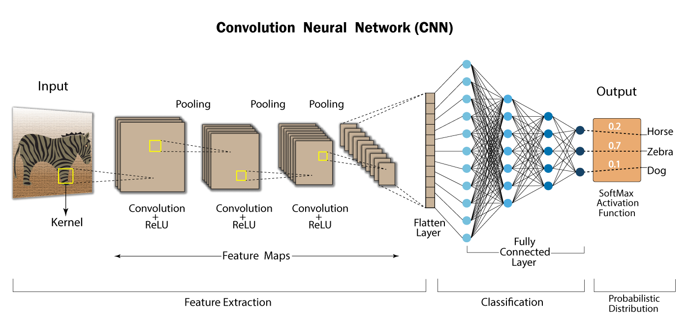

{/* ── SECTION 1 — GOAL ─────────────────────────────────────────────────── */}

<SessionSection id="goal" label="Goal">

## The problem: predict Egypt's capital

<ArchitectureEvolutionAnimator panel={0} />

</SessionSection>

{/* ── SECTION 2 — BIG PICTURE ──────────────────────────────────────────── */}

<SessionSection id="big-picture" label="Big Picture">

## Neural network: a straight-line mapping function

<LinearMappingGraph
  m={2}
  c={1}
  knownPoints={[
    { x: 0, y: 1, label: "x=0, y=1" },
    { x: 1, y: 3, label: "x=1, y=3" },
    { x: 2, y: 5, label: "x=2, y=5" },
    { x: 3, y: 7, label: "x=3, y=7" },
  ]}
/>

## Neural network: y = mx + c, stacked many times

<NNEquationDemo />

## CNN: same filter slides over every image position

<CNNImageSuccessDemo />

## CNN: convolutions → pooling → dense → classes

## CNN applied to text: window slides along the sentence

<ArchitectureEvolutionAnimator panel={1} />

## CNN fails: too short to look back to "Egypt"

<ArchitectureEvolutionAnimator panel={2} />

</SessionSection>

{/* ── SECTION 3 — CORE CONCEPTS (RNN) ──────────────────────────────────── */}

<SessionSection id="core-concepts" label="Core Concepts">

## RNN: same cell unrolled — state flows forward each step

<RNNCellUnrolledDiagram />

## RNN: one hidden state reads every token in order

<RNNUnrolledOverview
  title=""
  caption=""
  tokens={["Egypt", "is", "a", "country", "What", "is", "its", "capital"]}
  terminalNextToken="Cairo"
/>

## RNN: Egypt's memory is nearly gone by the time "its" arrives

<ArchitectureEvolutionAnimator panel={4} />

</SessionSection>

{/* ── SECTION 4 — PRACTICAL EXAMPLE (Transformer) ──────────────────────── */}

<SessionSection id="practical-example" label="Practical Example">

## Transformer: "its" attends directly to "Egypt"

<ArchitectureEvolutionAnimator panel={5} />

</SessionSection>

{/* ── SECTION 5 — RECAP ────────────────────────────────────────────────── */}

<SessionSection id="recap" label="Recap">

## What we covered

<RecapTable
  rows={[
    { term: "NN as a mapping function", definition: "y = mx + c: a neural network learns weights (m, c) so that inputs map to correct outputs." },
    { term: "Fixed window (CNN)", definition: "Sees only N consecutive tokens; any word outside that window is invisible — great for images, limited for long text." },
    { term: "Translation invariance", definition: "A CNN filter detects the same pattern wherever it appears in an image — the core reason CNNs dominated computer vision." },
    { term: "Recurrent hidden state (RNN)", definition: "A single vector h updated at every step; earlier tokens fade as new ones overwrite it." },
    { term: "Vanishing memory", definition: "After many steps h retains almost no signal from distant tokens — 'Egypt' is ~10% present by the time the model reads 'its'." },
    { term: "Self-attention (Transformer)", definition: "Every token computes scores against every other token in one parallel operation — distance has no cost." },
    { term: "Why Transformers won", definition: "They replaced sequential bottlenecks with direct, parallel, distance-independent token interactions." },
  ]}
/>

</SessionSection>

{/* ── SECTION 6 — NEXT SESSION ─────────────────────────────────────────── */}

<SessionSection id="next-session" label="Next Session">

<NextSessionCard
  title="The Transformer: Attention Is All You Need"
  slug="transformer-attention"
  teaser="Now that you see the problem, dive into the full Transformer architecture — positional encoding, Q/K/V attention heads, encoder and decoder stacks, and how it all connects into one forward pass."
  module={1}
/>

</SessionSection>
