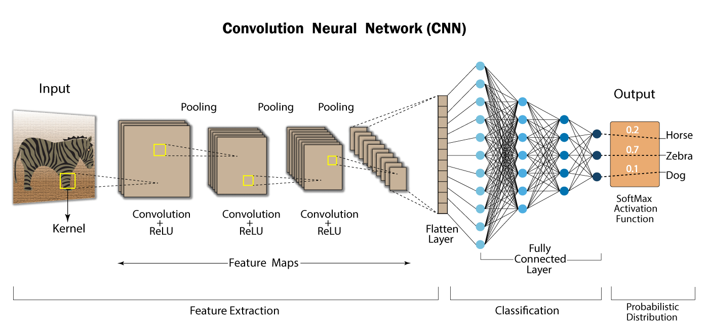

# Session images (`public/sessions/`)

Static assets for session MDX pages are grouped by **module** and **session slug** so paths stay predictable:

`public/sessions/module-{N}/{slug-or-topic}/`

Example (why-transformer):

- `module-1/why-transformer/cnn-architecture.png`

Reference from MDX with root-relative URLs:

```mdx

```

Images are styled globally via the session MDX `img` mapping in `app/sessions/[slug]/page.tsx`.
